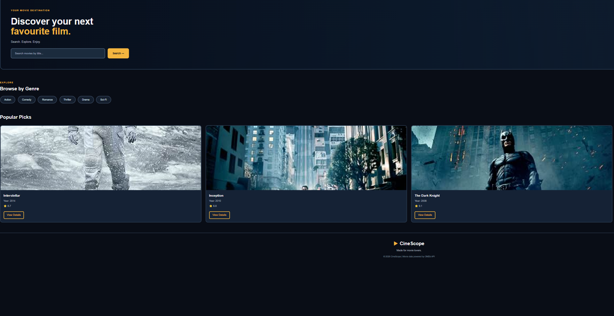
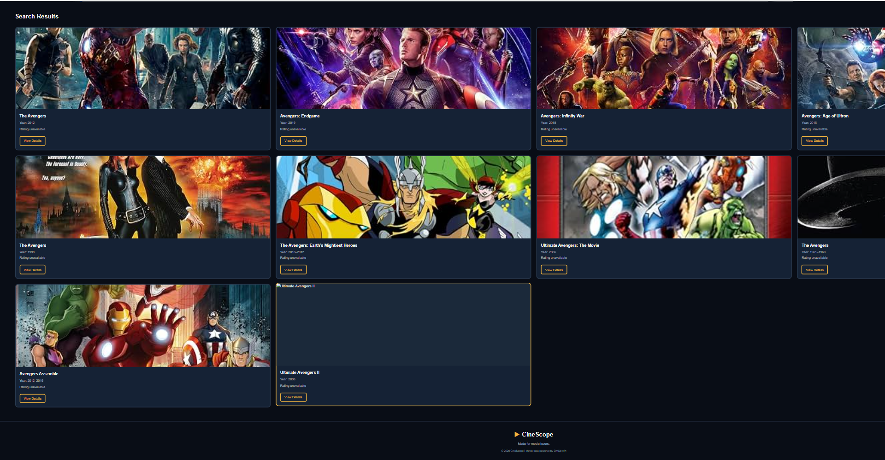
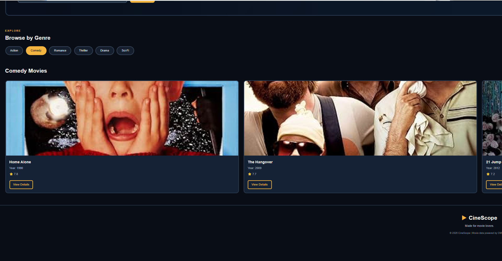
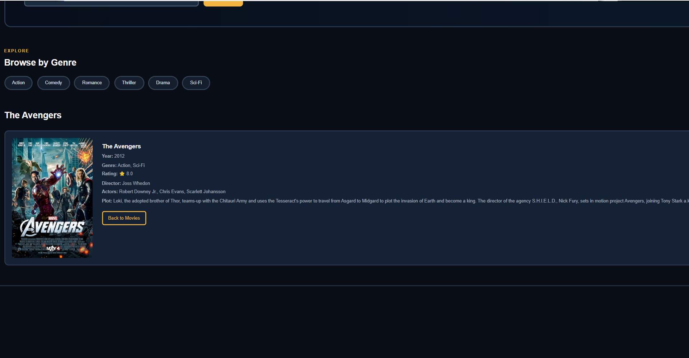

# 🎬 CineScope – Movie Discovery Web App

CineScope is a movie discovery web application that helps users search for movies, explore different genres, and view detailed movie information using the OMDb API.

## ✨ Features

- 🔍 Search movies by title
- 🎭 Browse movies by genre
- 🎬 Explore popular movie picks
- ⭐ View IMDb ratings
- 📖 Get detailed movie information
- 🖼️ Display movie posters
- 📱 Responsive design

## 🛠️ Tech Stack

- HTML5
- CSS3
- JavaScript
- OMDb API

## 📂 Project Structure

```text
CineScope/
│
├── assets/
│   ├── assets/
│   │   ├── home.png
│   │   ├── search-results.png
│   │   ├── genre-results.png
│   │   ├── movie-details.png
│   │   └── no-poster.png
│
├── index.html
├── style.css
├── script.js
└── README.md
```

## 🚀 How to Run

1. Clone or download this repository.
2. Open the CineScope folder in VS Code.
3. Get your API key from [OMDb API](https://www.omdbapi.com/apikey.aspx).
4. Open `script.js` and add your API key in the `API_KEY` variable.
5. Open `index.html` using the Live Server extension.
6. Search for movies and explore different genres!

## 🔑 API Used

This project uses the [OMDb API](https://www.omdbapi.com/) to retrieve movie information.

**Note:** An API key is required to use the movie search functionality. Do not share your API key publicly.

## 👩‍💻 Author

Akanksha Varshney

GitHub: [@akankshavarshney15-dotcom](https://github.com/akankshavarshney15-dotcom)
## 📸 Project Screenshots

### Home Page


### Search Results


### Browse by Genre


### Movie Details

